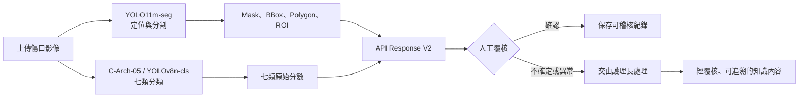
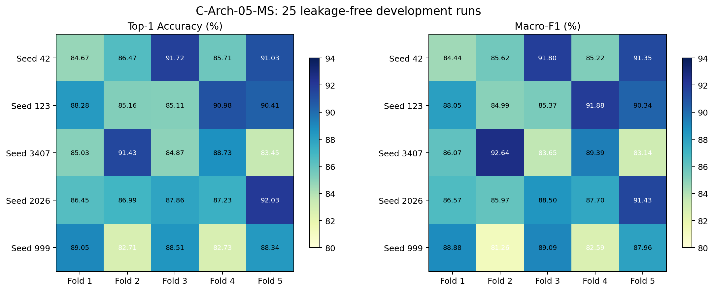
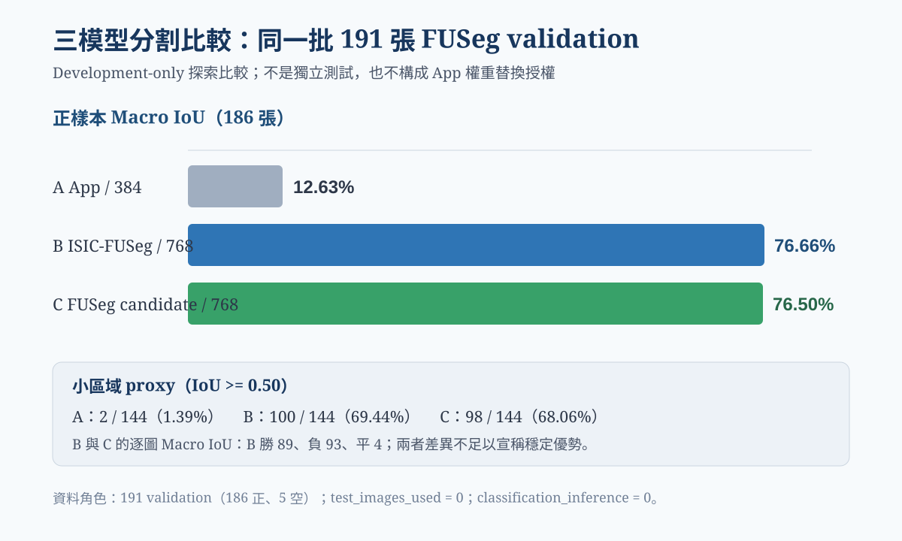
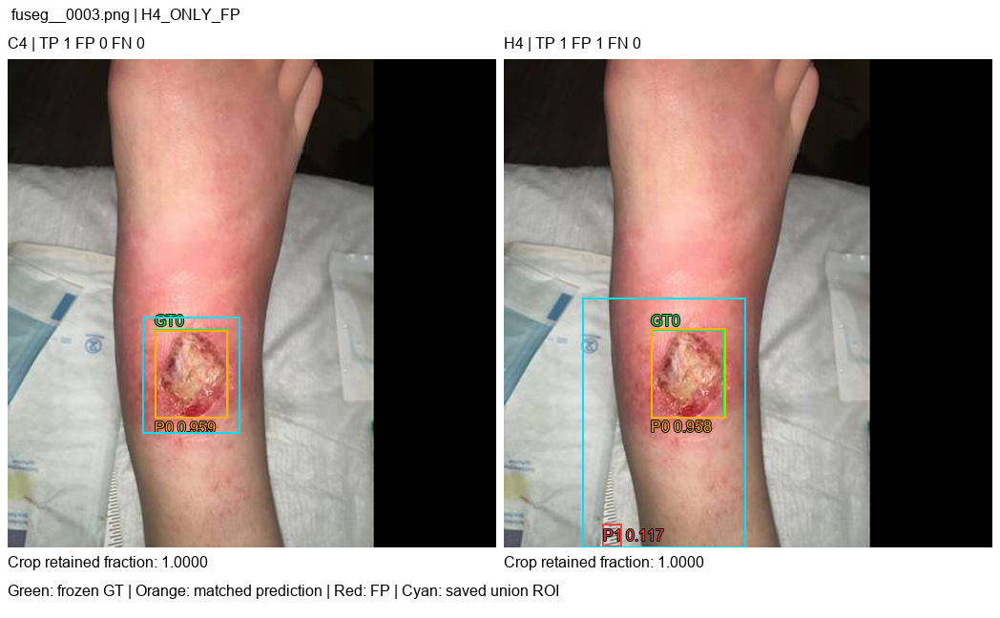
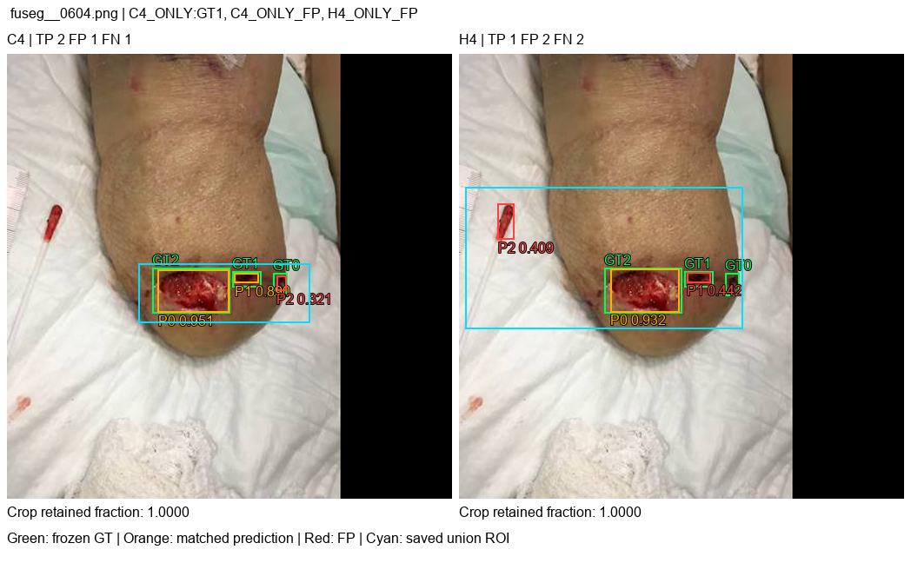
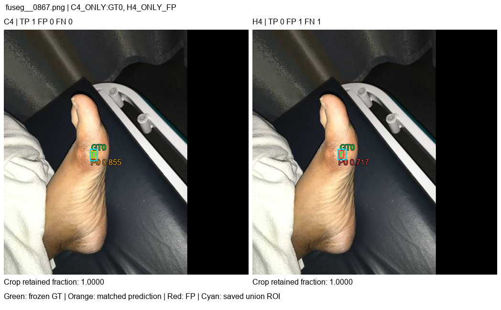

# 智慧型傷口分級與照護對應系統

> 畢業專題／研究型原型：先定位傷口、再提供七類分類與分割證據，最後由護理人員覆核。系統不取代臨床判斷，也尚未完成醫療器材或臨床效能驗證。

[完整研究進度報告](docs/PROJECT_PROGRESS_REPORT_20260929.md) · [公開彙總證據 JSON](docs/evidence/progress_20261024.json) · [App 操作與交付說明](docs/PROJECT_HANDOFF_20260914.md) · [GitHub 安全稽核](docs/GITHUB_SECURITY_AUDIT_20260906.md)

最新文件與軟體驗證更新：[2026-10-27 進度與重驗結果](docs/PROGRESS_UPDATE_20261027.md)。後端 14/14、前端 23/23、lint 與 production build 再次通過；沒有新增訓練、真模型推論、盲測或 App 權重替換。以下模型數字仍引用 2026-10-24 的封存彙總。

## 專案要解決什麼問題

傷口照片若只交給單一黑盒模型直接下結論，使用者很難知道模型看見了什麼、結果是否可信，以及何時應交由專業人員處理。本專案把流程拆成可檢查的步驟：

1. 分割模型找出可能的傷口區域，輸出 mask、邊界框與 ROI 證據。
2. 分類模型對完整影像輸出七類原始分數，不把拼圖格線誤稱為傷口框。
3. API 同時回傳模型身分、輸入尺寸、原始分數與未驗收狀態。
4. App 顯示結果與限制，所有案例都要求人工覆核。
5. 護理長確認後的建議才可進入具來源、版本、去識別化與撤回機制的知識流程；未設定規則時維持 `NOT_CONFIGURED`。



## 截至 2026-10-24 的可驗證成果

| 範圍 | 資料與方法 | 結果 | 可以怎麼解讀 |
|---|---|---:|---|
| 七類分類開發評估 | 720 張 development image；383 個 MD5 exact-content groups；5 seeds × 5 group-aware folds；保存預測列 3,600 筆 | Accuracy 87.39% ± 0.79 pp；Macro-F1 87.47% ± 0.78 pp | 五個 seed 各合併五折後的結果；25 次評估共享同一開發池，不是 25 個獨立資料集 |
| 分類鎖定測試 | 48 張；一次性內部測試，本輪未重開 | 46/48，Accuracy 95.83% | 樣本小且類別不平衡，不能因高於開發結果就宣稱臨床泛化較好 |
| FUSeg 分割訓練 | 771 train／191 development validation；YOLO11m-seg，300 epochs | Mask mAP50 90.32%；Mask mAP50–95 68.08% | 僅為 development 結果，不是獨立外部測試 |
| 三模型分割探索比較 | 同一批 FUSeg development validation 191 張，其中 186 張有傷口、5 張空 GT；test 使用 0 張 | 正樣本 Macro-IoU：A 12.63%、B 76.66%、C 76.50% | B/C 差距很小，逐圖為 B 勝 89、負 93、平 4；不能宣稱 B 穩定勝出，也未授權替換 App 模型 |
| App／API 驗證 | Response V2 契約、上傳競態、安全呈現與相容性測試 | 後端 14/14、前端 23/23；ESLint、TypeScript 與 Vite build 通過 | 代表已測的軟體契約通過，不等於臨床部署驗收 |

### 分類 5×5 的意思

「5×5」不是把 48 張測試圖加入 383 個群組，也不是把同一批圖片複製 25 次。它代表五個固定 random seeds，各自執行五折 GroupKFold。每一折都以完整 MD5 群組為單位分配 train／validation，完全相同的影像複本不會跨越兩邊；每個 seed 的五折合起來，720 張 development image 都恰好當過一次 validation。



圖中每格是一個模型實例。25 次 validation Accuracy 的範圍為 82.71%–92.03%，因此 README 不只報最好的一格。

### 分割模型的探索比較



模型 A 的高 Recall 伴隨大面積背景過覆蓋；B/C 明顯降低過覆蓋，但仍各有漏失，而且都在同一批 191 張 development validation 上反覆比較。這項結果標記為 `EXPLORATORY_NOT_DEPLOYMENT_ACCEPTANCE`。

### 模型框選案例

以下是已公開、可追溯的 FUSeg development 案例；圖中包含模型框／mask 與錯誤分析，不是未授權的醫院影像，也不是鎖定測試資料。完整選圖理由與 SHA-256 見[視覺資產清冊](docs/report_assets/progress_20260929/manifest.json)。

| 額外假陽性案例 | 多傷口案例 | 極小傷口案例 |
|---|---|---|
|  |  |  |

這三張圖用來解釋不同失敗機制，不能用三張圖推算整體成功率。

## 資料來源、數量與隔離

| 資料 | 使用數量 | 角色與隔離狀態 | 公開來源／證據 |
|---|---:|---|---|
| 七類分類 development | 720 張、383 個 exact-content groups | 只用於 5 seeds × 5 folds；MD5 群組不跨 train／validation | 原始發布 URL、版本、授權與逐圖來源仍不完整，因此不公開原圖，並標記為 `UNVERIFIED` |
| 七類分類 locked test | 48 張 | 與 development 分離；一次性評估後封存，不加入 383 groups、不回頭調參 | 僅公開聚合結果，不公開影像與逐圖預測 |
| FUSeg | 771 train、191 development validation；官方另有 200 test | 目前研究只使用 771/191；官方 test 僅比對既存 hash，像素使用 0 張 | [官方 repository](https://github.com/uwm-bigdata/wound-segmentation)、[固定版本的 challenge PDF](https://github.com/uwm-bigdata/wound-segmentation/blob/42a272dfe0679f20675e826385925cb7562934b6/data/Foot%20Ulcer%20Segmentation%20Challenge/FootUlcerSegmentationChallenge2021.pdf)、[資料集論文](https://arxiv.org/abs/2201.00414) |

MD5 在這裡只用來判斷檔案位元內容是否完全相同。它能阻止「同一張圖換檔名」跨到 train 與 validation，不能找出裁切、旋轉、重新壓縮後的近似重複，也不能取代病人 ID。公開資產與新封存證據另用 SHA-256 核對完整性。實作依據包括 [Python `hashlib`](https://docs.python.org/3/library/hashlib.html) 與 [scikit-learn `StratifiedGroupKFold`](https://scikit-learn.org/stable/modules/generated/sklearn.model_selection.StratifiedGroupKFold.html)。

## 重要問題、處理方式與目前結論

| 發現的問題 | 怎麼查證／處理 | 結論 |
|---|---|---|
| 一般五折讓重複影像跨 train／validation | 以 MD5 建立 exact-content group，再以 GroupKFold 分配完整群組 | 早期 98.34% 結果失效；改採零 exact-duplicate leakage 的開發評估 |
| 歷史統計寫成 3,622 列，但理論值應為 5×720 | 只讀 25 個保存 prediction arrays，逐列重建 | 正確為 3,600 列；因缺可靠 row→group 身分，新的 grouped bootstrap CI 維持阻塞，不捏造 |
| PIL RGB 與 NumPy BGR 介面混用 | 固定 checkpoint、191 張資料與所有門檻，只修正色彩契約 | F1 由 20.06% 恢復至 86.01%，但 Precision 與 crop 完整率仍未全過門檻 |
| seed 42 的小傷口加權抽樣看似成功 | 以五個 seeds 做配對確認並保留不利結果 | 完整門檻僅 2/5 通過，不能稱為穩定改善 |
| 將輸入尺寸由 768 提高到 1024 | 相同資料與評估條件做配對比較 | 總 TP 未增加，very-small TP 26→25，FP 30→35；不因解析度更高就升級 |
| App 可能顯示上一張影像的晚到結果 | 對每次上傳綁定 generation／request identity，失敗時清空舊結果 | 新檔、驗證失敗、上傳失敗與晚到回應都不會沿用舊結果 |
| 高信心不等於真的有傷口 | 當沒有可信 ROI 或輸入異常時，停止自動照護對應與 RAG 建議 | 維持人工覆核與 fail-closed；OOD 尚未驗證 |

## App 與 API 目前具備的能力

- API Response V2 回傳七類原始分數、原生 mask/RLE、bbox、polygon、合併 ROI、模型 basename／SHA-256／task／input size。
- 保留舊 V1 欄位以降低前端切換風險；新增欄位不假裝成臨床驗收結果。
- App 顯示 mask overlay、完整七類分數與必須人工覆核的狀態。
- 病人切換、EMR ID、上傳失敗、晚到回應與舊結果殘留都有保護。
- 照護規則目前為 `NOT_CONFIGURED`；OOD rejection 與實體面積量測為 `NOT_VALIDATED`。

## 如何驗證公開程式

先執行不需要真實患者資料、私有資料庫或模型權重的契約與前端安全測試：

```powershell
# 後端 Response V2 契約測試
python -m unittest discover -s tests -p test_api_response_v2.py -v

# 前端安全測試、靜態檢查與 production build
Push-Location wound_nurse_app
npm ci
npm test
npm run lint
npm run build
Pop-Location
```

完整本機預覽、環境變數、合成 fixture、測試帳號與停止方式請依[交付說明](docs/PROJECT_HANDOFF_20260914.md)操作。Python 入口不會自動讀取 `.env`；不得把正式 key、密碼或 DB 路徑寫進原始碼。

## 專案結構

```text
backend_main.py / woundcare_inference.py / woundcare_contract.py
    後端 API、推論整合與 Response V2 契約
wound_nurse_app/
    React + TypeScript 前端與 UX safety tests
experiments/
    分類、分割、統計重建與受控比較程式
tests/
    後端契約與研究防護測試
docs/
    方法、進度、模型卡、證據摘要與公開分析圖
```

## 建議閱讀順序

1. [最新完整進度、25 模型逐類分數、三模型分割比較、App 安全改動與參考依據](docs/PROJECT_PROGRESS_REPORT_20260929.md)
2. [分類修正後最終開發摘要](experiments/results/tables/Table2c_Final_Classification_Development_Summary.md)
3. [25 個 seed/fold 模型的總體分數](experiments/results/tables/Table_CV25_Overall_Performance.md)與[七類逐類分數](experiments/results/tables/Table_CV25_PerClass_Performance.md)
4. [完整白話方法、資料張數與隔離報告](docs/PROGRESS_AND_METHODS_20260915.md)
5. [FUSeg 模型卡與來源](docs/FUSEG_MODEL_CARD_20260914.md)
6. [專案結構](PROJECT_STRUCTURE_20260812.md)

## 目前限制與下一步

- 七類分類原圖的來源 URL、版本、授權與逐圖 lineage 尚未完整核實，因此不公開分類影像。
- 48 張 locked test 樣本小且不平衡；它只回答固定內部資料上的一次性表現，不是臨床成效證明。
- FUSeg 的 191 張資料已多次用於開發比較；下一步需要獨立 annotation QC 與新確認資料，不能繼續在同一批資料上選冠軍。
- B/C 分割候選尚未獲得 App 模型替換授權；目前 App 權重與研究候選保持分離。
- 瀏覽器視覺 QA、HTTP 真模型 smoke test、OOD rejection、實體尺度校正及臨床工作流程驗收尚未完成。
- Redscar 個別存取仍待官方核准。

## 公開與安全邊界

本公開儲存庫只放程式碼、設定範例、方法、聚合數字及經檢查的公開 FUSeg development 案例。不放患者影像、醫院場域資料、分類原圖、locked test、FUSeg test、完整資料集、模型權重、原始逐圖預測、資料庫、密鑰、`.env` 實值或私有部署證據。

本專案是畢業專題與研究原型，不是已取得醫療器材認證的臨床決策系統；任何模型輸出都必須由合格人員覆核。
