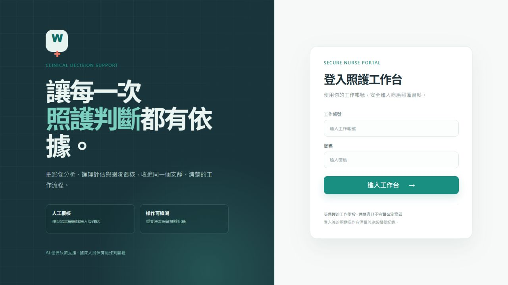
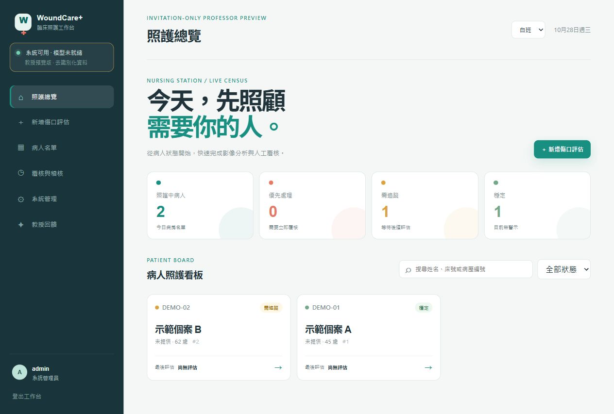
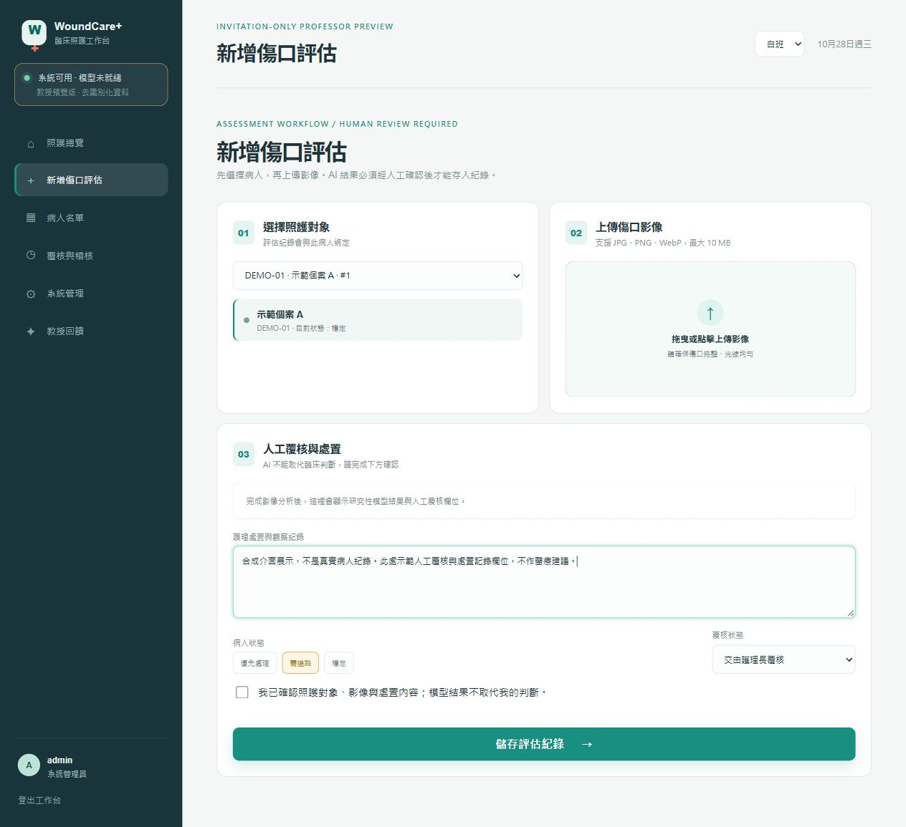
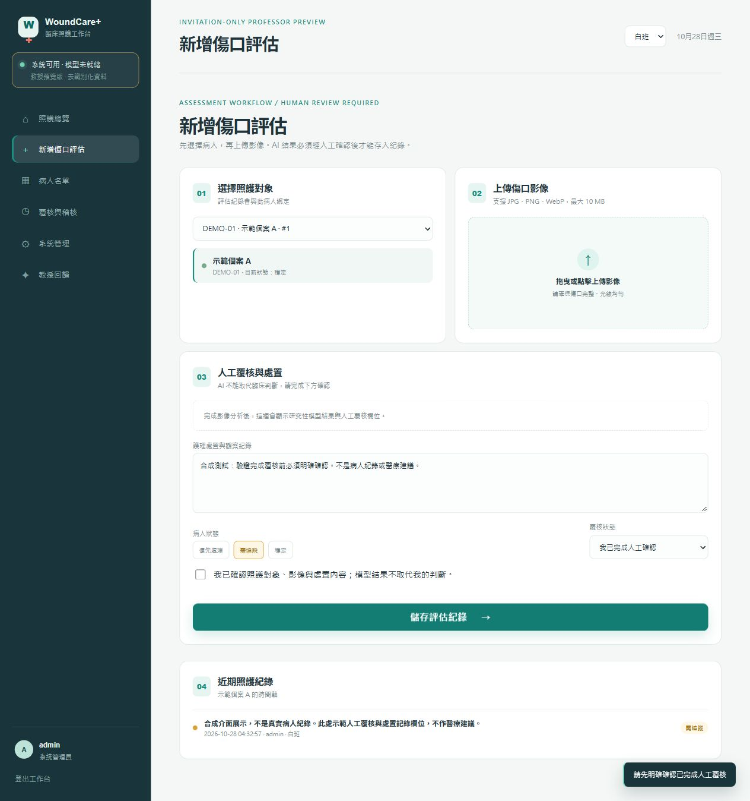
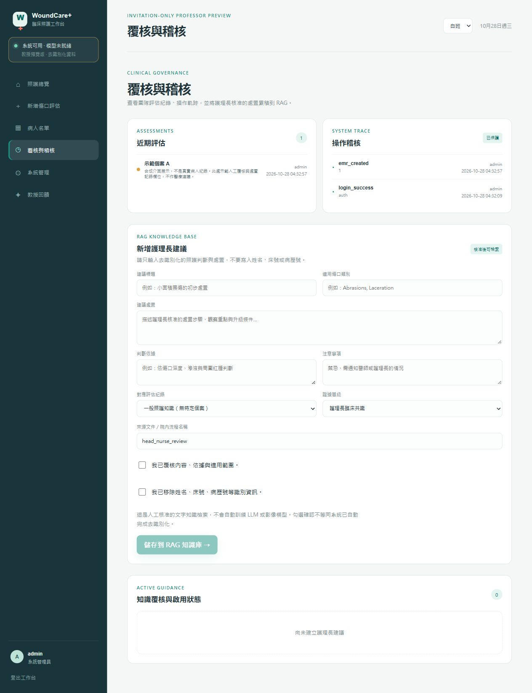

# 網頁端實機操作展示

2026 年 10 月 28 日，我在實際瀏覽器操作專案既有 React／FastAPI 網頁並擷取以下五張圖，不是設計稿，也沒有重繪或修改截圖像素。使用 `tests/run_local_preview_smoke.py` 的 loopback 拋棄式示範模式；個案 A／B、床號與文字皆為合成測試資料，不是真實患者。

這輪刻意不載入模型、不上傳傷口照片，不執行推論、訓練、分類 48 張 locked test 或 FUSeg official test。畫面上的「系統可用 · 模型未就緒」是實際狀態，不把空白結果區補成虛構模型輸出。完整圖檔尺寸與 SHA-256 見[截圖清冊](report_assets/web_demo_20261028/manifest.json)。

## 登入入口

工作帳號與密碼由同一入口登入；頁面同時說明人工覆核與操作追溯。截圖時輸入框為空，不公開帳密或工作階段 token。

## 照護看板

本次已實際登入並讀取示範 API 的兩位合成個案。看板呈現照護狀態、搜尋、篩選與新增評估入口，並清楚標示教授預覽及模型未就緒。這只展示資料流與介面，不是模型準確率或病人照護成效。

## 個案綁定與評估表單

選擇「示範個案 A」後，個案身分、上傳區、觀察紀錄、狀態、覆核選項與確認框位於同一流程。未上傳影像，因此沒有 mask、分類分數或照護建議，報告不將這張圖描述為模型推論成功。

實際操作釐清了一項狀態差別：「交由護理長覆核」可以先保存 `needs_review` 紀錄，**不等於已完成覆核**。本輪只在隔離資料庫新增一筆明寫合成展示的待覆核文字，沒有新增 `reviewed` 紀錄。

## 已覆核狀態的確認阻擋

選擇「我已完成人工確認」，但不勾確認框後按儲存，網頁顯示「請先明確確認已完成人工覆核」。這確認本次桌面操作中的前端 gate；後端亦有相應條件：[API 的 reviewed gate](../backend_main.py)要求 `review_status == "reviewed"` 時 `human_review_confirmed` 必須為真。不能概括寫成所有待覆核資料都禁止保存。

## 操作稽核與 RAG 雙確認

近期評估與操作稽核能對照合成文字、操作者與時間。RAG 表單保留適用類別、來源、判斷依據、注意事項，以及內容覆核、去識別化兩個確認；本次兩者皆未勾選，儲存按鈕停用，知識庫保持空白。

這輪沒有核准、啟用或發布任何照護政策，也沒有訓練 LLM。表單中的預設來源及證據層級不是專家簽核證據。

## 這些畫面能證明什麼

已觀察到：登入、兩個合成個案看板、評估表單、待覆核儲存、已覆核確認阻擋、操作稽核，以及未勾雙確認時的 RAG 停用狀態。

尚未驗證：真模型 HTTP 推論、mask／七類分數的此次瀏覽器展示、手機、慢網路、併發、真實臨床工作流程與正式部署資安。2026-10-27 的 14 項後端與 23 項前端測試結果仍是獨立證據，不因本次拍照而升級成全面 E2E PASS。

技術來源：[現有 App 原始碼](../wound_nurse_app/src/App.tsx)、[後端 API](../backend_main.py)、[既有隔離預覽程式](../tests/run_local_preview_smoke.py)。模型實驗、資料數量、來源與研究限制仍見[完整研究報告](PROJECT_PROGRESS_REPORT_20260929.md)。
