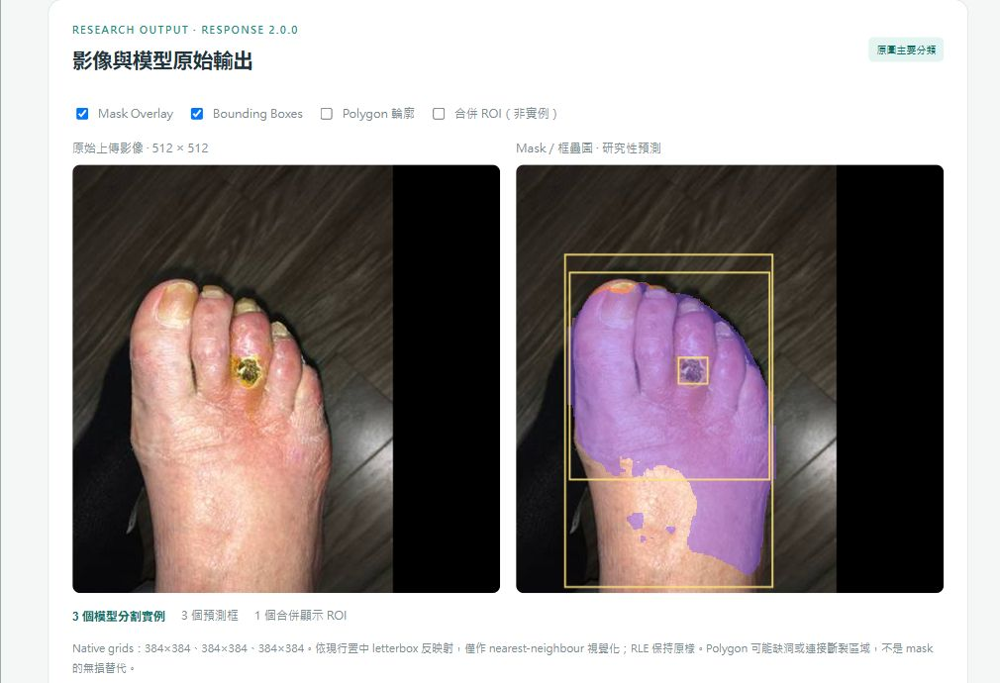
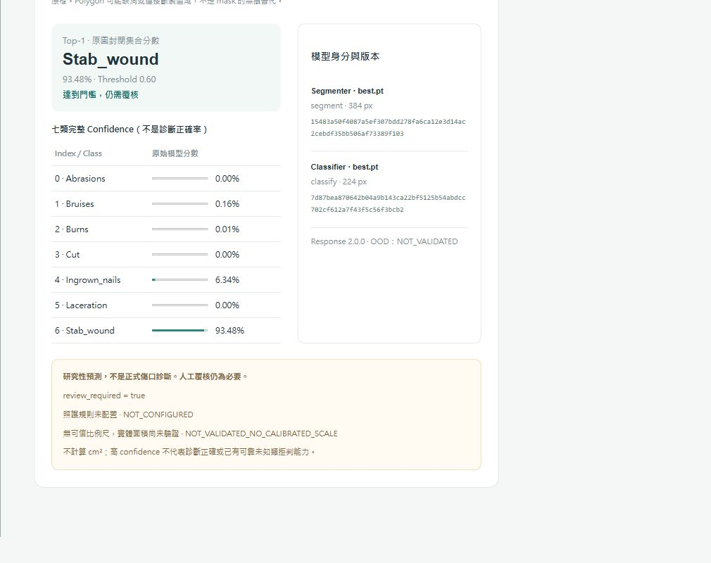
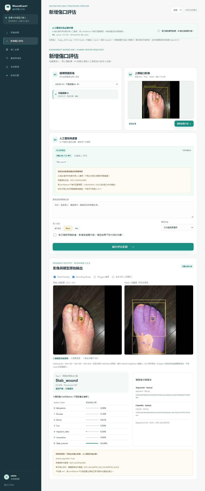

# 十月二十七日版本傷口辨識實機展示

我使用 **2026-10-27 建置的網頁**與原有指定 App 權重，於 **2026-10-28 實際擷取**以下畫面。這不是 10/27 當天拍攝，不沿用或更改 10/24 截圖日期。前後端原始碼與 10/27 發布 commit `af58d37` 一致，未修改已封版管線。

本次在 loopback 隔離資料庫登入合成個案 A，上傳一張 FUSeg development validation 影像，按下影像分析，取得真實 API 與兩個模型回傳；只送出一次預測，未使用分類 48 張 locked test 或 FUSeg official test，未訓練、未替換權重、未調門檻、未儲存照護評估。示範服務已停止。

## 傷口照片與模型標示

左側是輸入照片，右側紫色是模型預測遮罩，黃色是預測框。實際得到 **3 個模型分割實例、3 個預測框、1 個合併顯示 ROI**；這不等於三個獨立傷口。分類仍使用完整原圖，ROI 只是定位證據，不能說成已驗證的「裁切後分類」。

這張圖也暴露真實問題：遮罩涵蓋了大量正常腳部皮膚。我沒有改成理想範圍，不能將畫面描述為精準定位或臨床可用。

## 七類完整分數

Top-1 為 `Stab_wound`，顯示信心 **93.48%**、門檻 `0.60`。它是封閉七類集合的模型分數，不是本張影像的正確率或診斷確認。FUSeg 沒有此專案七類真值，因此本次不判定七類分類正誤。其他顯示值為 Bruises 0.16%、Burns 0.01%、Ingrown_nails 6.34%；畫面為 0.00% 的類別只是四捨五入，不表示原始分數為零。

模型維持 App 預設：YOLO11m-seg `384 px / conf=0.10` 與 YOLOv8n-cls `224 px / threshold=0.60`，CPU 推論，權重 SHA-256 見[本次清冊](report_assets/web_recognition_20261027_build/manifest.json)。未將 FUSeg 研究候選或 C-Arch-05 CV fold 換入 App。

人工覆核仍必要；照護規則 `NOT_CONFIGURED`、未知類拒判 `NOT_VALIDATED`，沒有可信比例尺便不提供傷口 cm²。本次僅一張開發影像的實機路徑，不代表完整真模型 HTTP 回歸、手機、慢網路、臨床驗收或 R14 隔離環境問題已解決。

## 完整操作頁面

## 影像來源與用途

公開影像為 `fuseg__0001.png`，角色為 development validation，之前已參與工程展示，不是未見外部驗證；SHA-256 為 `8cd00b6c175afbc69c777e82f2c8bef111734b8fbf8f3bb4fe21e59d0402f501`。照片不是本研究場域患者；畫面上的示範個案 A 與照片來源無病人身分關聯。

資料與作者歸屬：Chuanbo Wang、Amirreza Mahbod、Isabella Ellinger、Adrian Galdran、Sandeep Gopalakrishnan、Jeffrey Niezgoda、Zeyun Yu，*FUSeg: The Foot Ulcer Segmentation Challenge*。[官方資料庫](https://github.com/uwm-bigdata/wound-segmentation)、[原始論文](https://arxiv.org/abs/2201.00414)、[固定版本競賽資料使用文件](https://github.com/uwm-bigdata/wound-segmentation/blob/42a272dfe0679f20675e826385925cb7562934b6/data/Foot%20Ulcer%20Segmentation%20Challenge/FootUlcerSegmentationChallenge2021.pdf)。既有來源稽核記錄其資料使用欄為 CC BY NC、未註版本；本圖僅作非商業學術說明，不將專案程式授權延伸到照片。

截圖由實際瀏覽器直接保存；兩張局部圖是瀏覽器 screenshot clip 擷取，不重繪或修飾模型像素。完整圖與局部圖雜湊列於清冊；原始 API 回應留在本機，不公開 DB、密鑰、權重或完整資料集。
